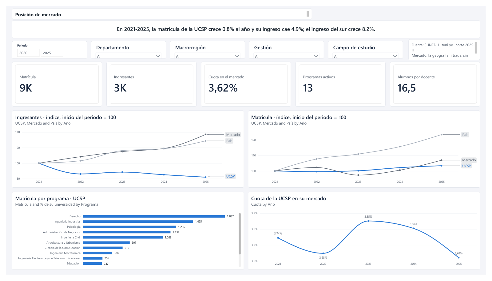
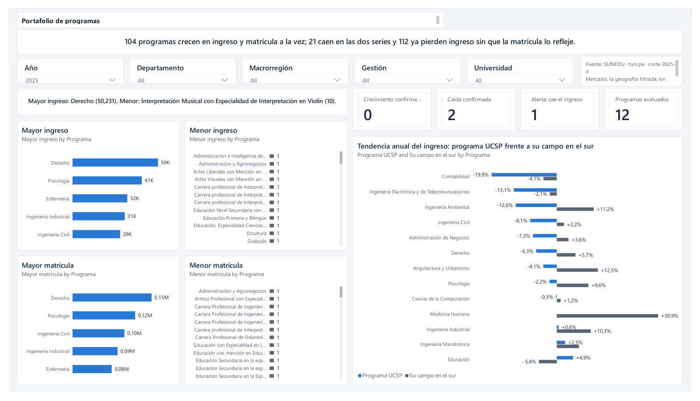
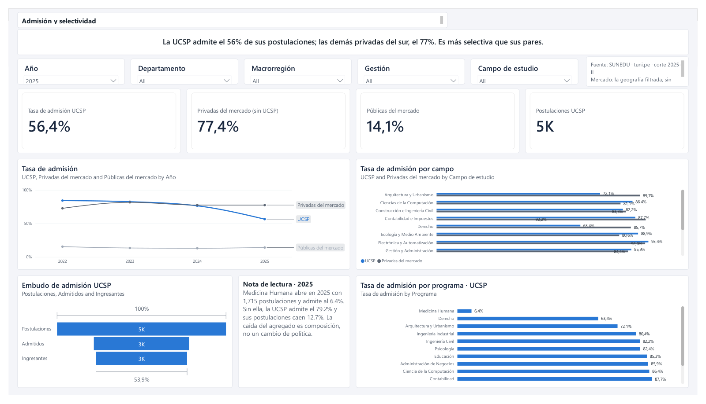

# Prueba técnica — Analista de Datos (UCSP)

Evolución de la oferta académica (ingresantes) y la matrícula de pregrado de la **Universidad Católica San Pablo** frente a la macrorregión sur y al país, con los datos abiertos de SUNEDU publicados en [tuni.pe/datos](https://tuni.pe/datos).

## Ejecutar

```bash
pip install -r requirements.txt
python run_all.py
```

No hay pasos manuales: el pipeline descubre los datasets en la API de TUNI, los descarga, los transforma y deja el modelo listo para Power BI.

**Requisitos:** Python 3.10+, conexión a internet y unos 2 GB de disco libre.

**Duración medida:**

| Corrida | Tiempo |
|---|---|
| Desde cero, incluida la descarga de 1 270 MB | 23 min 13 s |
| Con los zips ya descargados | 19 min 21 s |

Una sola etapa se corre con `python run_all.py 04_tendencias`. Para validar todo el SQL contra un esquema vacío, sin datos, en 3 segundos: `python validar_sql.py`.

## Pipeline

```
API de TUNI ──► 01 descargar ──► 02 transformar (SQL) ──────────────► 03 calidad ──► 04 tendencias ──► Power BI
                data/bronze      bronze → silver → gold                 17 controles   regresión          3 páginas
                56 zips          (DuckDB)   data/gold/*.parquet                         por programa
```

| Etapa | Qué hace | Salida | Tiempo |
|---|---|---|---|
| `01_descargar.py` | Resuelve la cadena de descarga de TUNI y baja el catálogo completo. Si el sha256 coincide, no vuelve a descargar | `data/bronze/*.zip`, `manifiesto.csv` | 3 min 45 s (2 s en caliente) |
| `02_transformar.py` | Ejecuta `sql/bronze` → `sql/silver` → `sql/gold`. Toda la lógica está en SQL; Python solo orquesta | 12 tablas en `data/gold/*.parquet` | 19 min |
| `03_calidad.py` | Corre los controles de `sql/calidad.sql`; 3 son los principales | `salidas/calidad/qc_resultados.csv` | 13 s |
| `04_tendencias.py` | Regresión de tendencia sobre ingresantes y matrícula, por programa | `dim_tendencia_programa.parquet` | 3 s |
| `05_diccionario.py` | Documenta el modelo leyendo la base | `docs/diccionario_datos.md` | < 1 s |

## Power BI

`UCSP_Benchmark.pbix` tiene el modelo, con 12 tablas, 23 relaciones y 76 medidas, y el informe de tres páginas de 1920 × 1080. Cada página abre con un titular que se reescribe con los filtros:

1. **Posición de mercado**: pregunta 4.1.
2. **Portafolio de programas**: preguntas 4.2 y 4.3.
3. **Admisión y selectividad**: pregunta 4.4.

**Filtros:** periodo, departamento, macrorregión y gestión en las tres páginas. La UCSP es el sujeto fijo: la geografía y la gestión definen el mercado contra el que se compara; sin filtro, ese mercado es la macrorregión sur.

Si el proyecto se mueve de carpeta, se cambia el parámetro `RutaGold` (*Transformar datos → Editar parámetros*) y se actualiza.





## Dónde está cada cosa

| Para revisar | Archivo |
|---|---|
| Diccionario de datos y catálogo de medidas (entregable 5.3) | [`docs/diccionario_datos.md`](docs/diccionario_datos.md) · [`docs/catalogo_medidas.md`](docs/catalogo_medidas.md) |
| Controles de calidad y sus resultados | [`sql/calidad.sql`](sql/calidad.sql) · [`salidas/calidad/qc_resultados.csv`](salidas/calidad/qc_resultados.csv) |
| Componente estadístico | [`04_tendencias.py`](04_tendencias.py) |
| Notebook PySpark para Microsoft Fabric | [`fabric/`](fabric/) |
| Modelo estrella para PostgreSQL y SQL Server | [`sql/ddl_postgres.sql`](sql/ddl_postgres.sql) · [`sql/ddl_sqlserver.sql`](sql/ddl_sqlserver.sql) |
| Presentación técnica: decisiones, sustento y limitaciones | `salidas/PPT_Tecnica_UCSP.pptx` |

## Uso de inteligencia artificial

Se usó **Claude (Anthropic)** como asistente en tres frentes:

- la ingeniería inversa de la API de TUNI;
- la redacción del código, que se ejecutó y verificó etapa por etapa;
- los borradores de la documentación.

Las decisiones de diseño y su sustento están en la presentación técnica. Todas las cifras citadas salen de ejecutar el pipeline.
